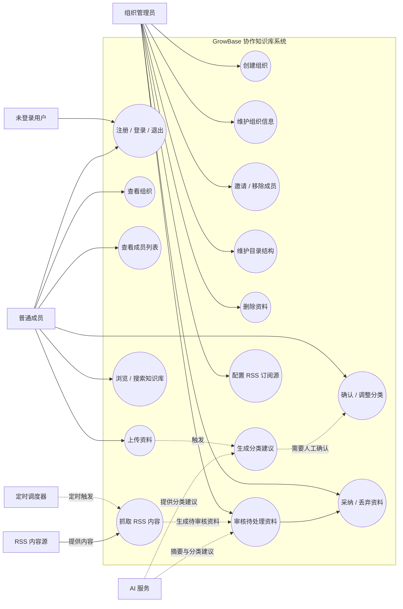

# GrowBase 需求分析

## 1. 文档目的

本文档是 GrowBase 的第一版需求分析基线，用于在编码前明确：

- 系统要解决什么问题；
- 谁会使用系统；
- 用户希望完成哪些目标；
- 哪些需求属于第一阶段，哪些属于后续阶段；
- 后续概要设计、数据库设计、接口设计和测试应以什么为依据。

当前仓库中的 `readme.md` 为空，因此本文档根据现有 `usecase_diagram.html`、前端页面和后端接口整理而成。尚未确认的内容以“待确认”标记。

## 2. 项目背景与问题定义

个人或小型团队在学习、研发和工作过程中会积累大量资料。资料通常分散在本地文件、聊天记录、网页和不同的云盘中，导致：

1. 资料难以按团队约定的知识结构归档；
2. 团队成员之间缺少统一的知识库；
3. 成员权限和资料维护责任不清晰；
4. 新资料进入知识库时，需要重复完成分类和整理；
5. 可信信息源的持续跟踪依赖人工操作。

GrowBase 旨在提供一个以“组织”为边界的协作知识库。用户可以创建或加入组织，组织管理员维护成员和目录结构，组织成员浏览和贡献资料，后续由 AI 和 RSS 工作流协助完成资料分类及知识库的持续更新。

## 3. 产品目标

### 3.1 第一阶段目标

第一阶段先完成一个可运行的组织协作基础：

- 用户可以注册、登录和退出；
- 用户可以创建组织并查看自己加入的组织；
- 组织管理员可以邀请和移除成员；
- 组织管理员可以维护树形知识库目录；
- 成员可以查看组织信息、成员列表和目录结构；
- 系统按照组织和角色限制数据访问与管理操作。

### 3.2 后续阶段目标

以下目标已出现在原有用例图中，但当前代码尚未形成完整业务闭环：

- 上传和删除知识资料；
- AI 自动分类或推荐分类；
- 成员确认、调整 AI 分类结果；
- 配置可信 RSS 订阅源；
- 定时抓取 RSS 内容；
- 生成临时资料或临时目录；
- 管理员审核并采纳或丢弃自动生成内容；
- 在知识库内搜索和浏览资料。

## 4. 系统边界

### 4.1 系统内部

- 用户认证；
- 组织管理；
- 组织成员与角色管理；
- 知识库目录管理；
- 资料管理；
- AI 分类工作流；
- RSS 订阅与自生长工作流。

### 4.2 系统外部参与者

- 普通成员；
- 组织管理员；
- AI 服务；
- RSS/外部内容源；
- 定时任务调度器（待确认是否独立建模）。

“数据库”“前端页面”“后端 API”属于系统实现组成部分，不应在业务用例图中作为用户角色出现。

## 5. 参与者识别

| 参与者 | 说明 | 主要目标 |
| --- | --- | --- |
| 未登录用户 | 尚未通过认证的访问者 | 注册账号、登录系统 |
| 普通成员 | 已加入组织、没有管理权限的用户 | 查看组织、浏览目录、使用知识库、贡献资料 |
| 组织管理员 | 组织的 owner 或 admin | 管理组织、成员、目录和资料 |
| AI 服务 | 外部或内部的模型服务 | 分析资料、推荐分类、生成结构化结果 |
| RSS 内容源 | 外部信息来源 | 提供待抓取的文章或信息 |
| 定时调度器 | 触发周期任务的系统角色，待确认 | 定时执行 RSS 抓取和自生长任务 |

角色关系：

- 组织管理员拥有普通成员的全部能力；
- 一个组织至少有一个 owner；
- 当前实现中 `owner` 和 `admin` 都可以执行管理操作，但 owner 不能被移除；
- 普通成员和管理员是“组织内角色”，不是全局用户类型。

## 6. 功能需求

### 6.1 认证管理

| 编号 | 需求 |
| --- | --- |
| FR-A01 | 系统应允许用户使用邮箱、用户名和密码注册账号。 |
| FR-A02 | 系统应校验邮箱和用户名的唯一性。 |
| FR-A03 | 用户应能够使用邮箱和密码登录。 |
| FR-A04 | 登录成功后系统应建立用户会话或返回访问令牌。 |
| FR-A05 | 用户应能够退出登录。 |
| FR-A06 | 未登录用户不得访问组织数据。 |

### 6.2 组织管理

| 编号 | 需求 |
| --- | --- |
| FR-O01 | 登录用户应能够创建组织。 |
| FR-O02 | 创建组织的用户自动成为该组织 owner。 |
| FR-O03 | 用户应能够查看自己所属的组织列表。 |
| FR-O04 | 组织成员应能够查看组织名称、描述和成员数量。 |
| FR-O05 | 管理员应能够修改组织名称和描述。 |
| FR-O06 | 用户不得访问自己未加入的组织。 |

### 6.3 成员与权限管理

| 编号 | 需求 |
| --- | --- |
| FR-M01 | 管理员应能够通过已注册用户的邮箱邀请成员。 |
| FR-M02 | 邀请成员时应能够指定 `member` 或 `admin` 角色。 |
| FR-M03 | 组织成员应能够查看成员列表及角色。 |
| FR-M04 | 管理员应能够移除普通成员或管理员。 |
| FR-M05 | 系统不得允许移除组织 owner。 |
| FR-M06 | 普通成员不得执行成员、组织和目录管理操作。 |

### 6.4 知识库目录管理

| 编号 | 需求 |
| --- | --- |
| FR-C01 | 成员应能够查看组织的树形目录。 |
| FR-C02 | 管理员应能够创建顶级目录。 |
| FR-C03 | 管理员应能够创建子目录。 |
| FR-C04 | 管理员应能够修改目录名称和描述。 |
| FR-C05 | 管理员应能够删除目录。 |
| FR-C06 | 删除目录时，系统应明确处理子目录和目录下资料。该规则待确认。 |
| FR-C07 | 目录应支持排序或稳定的显示顺序。 |

### 6.5 资料管理（第二阶段）

| 编号 | 需求 |
| --- | --- |
| FR-D01 | 成员应能够上传资料。 |
| FR-D02 | 系统应保存资料的名称、来源、类型、内容或存储地址、所属目录和上传者。 |
| FR-D03 | 成员应能够浏览和搜索有权访问的资料。 |
| FR-D04 | 资料上传后，系统可调用 AI 服务生成分类建议。 |
| FR-D05 | 成员应能够确认或调整 AI 的分类建议。 |
| FR-D06 | 管理员或资料所有者应能够删除资料。 |

### 6.6 RSS 与知识库自生长（第三阶段）

| 编号 | 需求 |
| --- | --- |
| FR-R01 | 管理员应能够配置可信 RSS 订阅源。 |
| FR-R02 | 系统应能够按计划抓取订阅源。 |
| FR-R03 | 系统应能够将抓取内容形成待审核资料。 |
| FR-R04 | 系统可使用 AI 为待审核资料推荐目录和摘要。 |
| FR-R05 | 管理员应能够审核、采纳或丢弃待审核资料。 |
| FR-R06 | 被采纳的资料才进入正式知识库。 |

## 7. 非功能需求

| 编号 | 类别 | 需求 |
| --- | --- | --- |
| NFR-01 | 安全性 | 密码不得以明文保存，接口必须校验身份和组织权限。 |
| NFR-02 | 安全性 | 用户只能读取自己所属组织的数据。 |
| NFR-03 | 一致性 | 成员邀请、移除、角色校验等操作应保持数据一致。 |
| NFR-04 | 可用性 | 常用操作应给出成功、失败和权限不足的明确反馈。 |
| NFR-05 | 可维护性 | 认证、组织、资料和 AI 工作流应保持相对独立。 |
| NFR-06 | 可扩展性 | 目录结构应支持后续挂载资料、标签和搜索索引。 |
| NFR-07 | 可审计性 | 后续应记录关键管理操作，如邀请、移除、删除和审核。 |
| NFR-08 | 性能 | 组织列表、成员列表和目录展示应在正常规模下快速返回。具体指标待确认。 |

## 8. 核心业务规则

1. 用户是系统级实体，成员关系是组织级实体。
2. 同一用户可以加入多个组织，在不同组织中可以拥有不同角色。
3. owner 是组织的创建者，至少存在一个 owner。
4. owner 和 admin 具有管理权限，member 只有普通使用权限。
5. 未加入组织的用户不能访问该组织的任何业务数据。
6. AI 的分类结果默认是“建议”，不能绕过人工审核直接修改正式知识库，除非产品明确允许自动采纳。
7. RSS 抓取内容应先进入临时区或待审核区，再进入正式知识库。

## 9. 核心用例图

下面是需求阶段的逻辑用例图。它描述“谁想完成什么目标”，不是接口图，也不是数据库关系图。

## 10. 典型用例描述：上传资料并确认分类

### 用例编号

UC-D01

### 用例名称

上传资料并确认分类

### 主要参与者

普通成员、组织管理员

### 前置条件

- 用户已经登录；
- 用户已经加入目标组织；
- 目标组织存在可用目录。

### 基本流程

1. 用户进入目标组织的知识库。
2. 用户选择上传资料。
3. 系统校验文件类型、大小和用户权限。
4. 系统保存资料及其基本元数据。
5. 系统请求 AI 服务生成分类建议。
6. 系统向用户展示分类建议。
7. 用户确认建议，或选择其他目录。
8. 系统将资料正式归档到选定目录。

### 异常流程

- 文件格式不支持：系统拒绝上传并说明原因。
- 文件过大：系统拒绝上传并说明允许的大小。
- AI 服务不可用：资料保留为“待分类”，用户可以手动选择目录。
- 用户没有组织权限：系统拒绝操作。
- 目标目录已被删除：系统要求用户重新选择目录。

### 后置条件

- 资料已保存；
- 资料拥有明确状态：待分类、已分类或审核中；
- 用户能够在有权限的范围内浏览该资料。

## 11. 当前实现与需求的差距

当前代码已经覆盖：

- 注册、登录和当前用户认证；
- 创建组织和查看组织列表；
- 组织详情；
- 成员列表；
- 邀请和移除成员；
- 组织名称和描述的后端更新接口；
- 树形目录的增、改、删和展示；
- 基本的 owner/admin/member 权限判断。

当前代码尚未覆盖：

- 资料实体、文件存储和资料上传；
- 资料浏览和搜索；
- AI 服务接入；
- RSS 订阅源和定时抓取；
- 临时资料审核流程；
- 操作审计；
- 完整的前端组织编辑入口；
- 更严格的目录删除级联规则校验。

## 12. 待确认问题

以下问题会直接影响后续设计，建议在进入概要设计前确定：

1. GrowBase 的首要用户是个人学习者、小型研发团队，还是企业团队？
2. 第一阶段是否只做“组织和目录”，还是必须包含资料上传？
3. 资料允许哪些格式：Markdown、PDF、Word、图片、网页链接，还是全部支持？
4. 资料实际存储在哪里：本地磁盘、对象存储，还是只保存链接？
5. AI 分类是自动执行、用户手动触发，还是上传后异步执行？
6. AI 结果是否必须人工确认后才能进入正式知识库？
7. RSS 是每个组织独立配置，还是系统级公共订阅源？
8. 删除目录时，子目录和目录下资料如何处理？
9. admin 是否可以修改 owner、移除其他 admin 或删除组织？
10. 是否需要邀请邮件、密码找回、登录过期和注销账号？

## 13. 下一步

需求分析完成后，建议按以下顺序继续：

1. 确认第 12 节的产品决策；
2. 为每个核心用例补充前置条件、主流程、异常流程和后置条件；
3. 画系统上下文图和业务流程图；
4. 根据确认后的需求建立实体关系模型；
5. 设计 REST API 和状态流转；
6. 编写验收标准和测试用例；
7. 再进入实现迭代。
