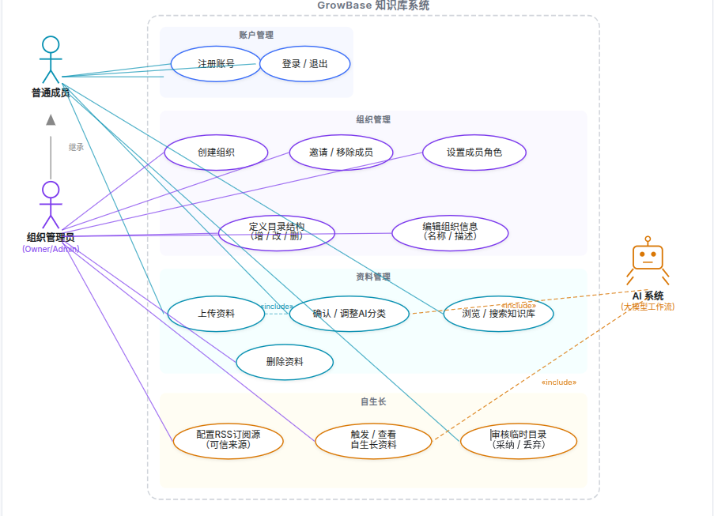

```
Organization Owner
        │
        ├── 创建组织
        ├── 邀请成员
        ├── 设置角色
        ├── 创建知识库
        └── 设置知识库管理员


Knowledge Manager
        │
        ├── 定义知识框架
        ├── 定义分类规则
        ├── 修改知识树
        ├── 审核低置信度知识
        ├── 审核知识关系
        └── 审核生长建议


Member
        │
        ├── 上传资料
        ├── 查看知识
        ├── 搜索知识
        ├── AI问答
        ├── 查看知识图谱
        └── 提出知识修改


AI System
        │
        ├── 内容解析
        ├── 自动摘要
        ├── 标签生成
        ├── 自动分类
        ├── 关系发现
        ├── 重复检测
        ├── 知识聚类
        ├── 结构优化
        └── 知识缺口发现
```


```
                        【团队负责人】
                              │
                              ▼
                        创建 Organization
                              │
                              ▼
                       创建 Knowledge Base
                              │
                              ▼
                        定义 Knowledge Tree
                              │
                              ▼
                       定义节点语义与规则
                              │
                              ▼
                         【知识骨架】
                              │
══════════════════════════════╪════════════════════════════
                              │
                          【团队成员】
                              │
                              ▼
                        持续提交资料
                              │
                 ┌────────────┼─────────────┐
                 ▼            ▼             ▼
                PDF          URL          GitHub
                 │            │             │
                 └────────────┼─────────────┘
                              ▼
                         【AI Pipeline】
                              │
                     ┌────────┼────────┐
                     ▼        ▼        ▼
                    摘要      标签     关键词
                              │
                              ▼
                         语义理解
                              │
                              ▼
                     Knowledge Tree匹配
                              │
                              ▼
                         分类置信度
                              │
                 ┌────────────┼─────────────┐
                 ▼            ▼             ▼
                高            中            低
                 │            │             │
              自动入库      成员确认      Manager审核
                 │            │             │
                 └────────────┼─────────────┘
                              ▼
                        【Knowledge】
                              │
                     ┌────────┼────────┐
                     ▼        ▼        ▼
                  Embedding  Relation  RAG
                     │        │        │
                     └────────┼────────┘
                              ▼
                       【知识持续积累】
                              │
                              ▼
                    Self-Growing Engine
                              │
              ┌───────────────┼────────────────┐
              ▼               ▼                ▼
          Density分析      Cluster分析       Gap分析
              │               │                │
              └───────────────┼────────────────┘
                              ▼
                       Growth Proposal
                              │
                              ▼
                           Manager
                              │
                     ┌────────┴────────┐
                     ▼                 ▼
                  Approve            Reject
                     │
                     ▼
                  更新知识树
                     │
                     ▼
                【Knowledge Growth】
                     │
                     └──────────────→ 下一轮知识输入
```


1. AI 分类准确性被高估了
大模型对文档分类并不稳定，尤其当目录结构本身有歧义时，分类错误会积累成一个"没人信任的知识库"。你需要一个明确的人工纠错机制，否则错误分类会越来越多但越来越难发现。

2. "自生长"定义模糊，边界不清
"AI 自动检索相关资源"——从哪里检索？公开互联网？特定数据源？检索回来的内容谁来验证质量？未经验证的内容混入知识库会迅速降低整体可信度。这个功能如果没有严格的质量门控，比没有这个功能更糟。

3. 组长权限设计存在实际风险
框架一旦定下后，如果业务方向变了，调整目录结构会导致大量已有内容分类失效。你需要考虑"框架演化"的路径，而不是假设初始框架是稳定的。

4. 缺少知识质量的生命周期管理
知识库最大的问题不是内容不够多，而是内容过时了但没人发现。你的方案里没有提到内容的时效性标记、过期提醒或版本控制，这会让知识库随时间退化。

5. 和现有工具的差异化不够清晰
Notion + AI 插件、Confluence + Copilot 已经在做类似的事情。你的方案在哪个点上有足够的差异，让团队愿意迁移过来或从头用你的工具？如果答案只是"更便宜"或"更简单"，那护城河很浅。




1.使用邮箱注册但是没有验证码，随便编了一个邮箱也可以注册
2.创建了一个组织但是邀请成员失败，显示要管理员权限